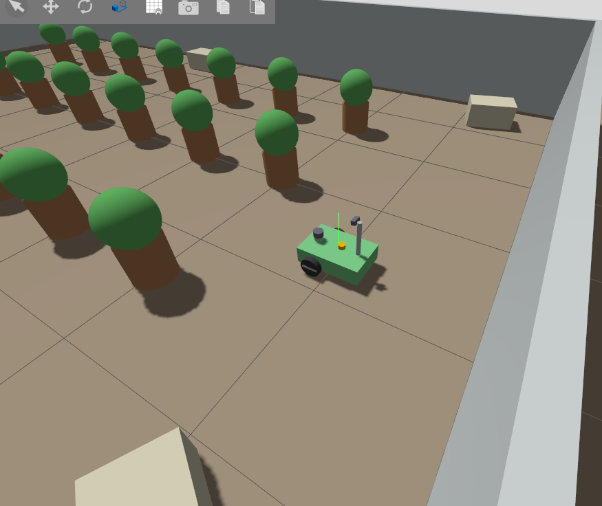

# SeraBot

Sera koridorlarında devriye gezen, engellerden kaçan ve kırmızı etiketli hasta bitkiyi fark eden diferansiyel sürüşlü mobil robot.
BIMU4101 – Introduction to Mobile Robotics, Midterm Project.



## Ortam
- Ubuntu 26.04 LTS
- ROS 2 Lyrical
- Gazebo Jetty

## Paketler
| Paket | İçerik |
|---|---|
| `serabot_description` | URDF/Xacro robot modeli, modeli RViz'de gösteren `display.launch.py` |
| `serabot_gazebo` | Sera dünyası (`greenhouse.sdf`), `sim.launch.py`, `ros_gz_bridge` ayarları, RViz config |
| `serabot_behavior` | Python davranış düğümleri |

## Kurulum

### 1. Bağımlılıklar
ROS 2 Lyrical ve Gazebo Jetty kurulu olmalı. Ek paketler:
```bash
sudo apt install ros-lyrical-ros-gz ros-lyrical-xacro ros-lyrical-robot-state-publisher \
  ros-lyrical-joint-state-publisher-gui ros-lyrical-teleop-twist-keyboard ros-lyrical-tf2-tools
```

### 2. Klonlama ve build
Repo kökü aynı zamanda colcon workspace'idir.
```bash
git clone https://github.com/metehanyurdunusvn/serabot.git ~/serabot
cd ~/serabot
source /opt/ros/lyrical/setup.bash
colcon build --symlink-install
source install/setup.bash
```
> Yeni bir dosya eklendiğinde `colcon build` tekrar çalıştırılmalıdır. `--symlink-install` sayesinde var olan dosyalardaki değişiklikler için build gerekmez.

## Çalıştırma

### Simülasyon (Gazebo + RViz)
```bash
ros2 launch serabot_gazebo sim.launch.py
```
Sırasıyla Gazebo'yu sera dünyasıyla, `robot_state_publisher`'ı, robotun spawn edilmesini, `ros_gz_bridge`'i ve RViz'i başlatır.

| Argüman | Varsayılan | Açıklama |
|---|---|---|
| `world` | `greenhouse.sdf` | Gazebo world dosyası |
| `x`, `y`, `yaw` | `-4.0`, `0.7`, `0.0` | Başlangıç konumu ve yönü |
| `rviz` | `true` | RViz açılsın mı |

### Teleop ile sürüş
`/cmd_vel` `geometry_msgs/msg/TwistStamped` tipindedir, bu yüzden `stamped:=true` gerekir:
```bash
ros2 run teleop_twist_keyboard teleop_twist_keyboard --ros-args -p stamped:=true
```
`i` ileri, `,` geri, `j`/`l` dönüş, `k` dur.

### Sadece robot modeli (Gazebo olmadan)
```bash
ros2 launch serabot_description display.launch.py
```

## Konular
| Konu | Mesaj tipi | Yön | Görselleştirme |
|---|---|---|---|
| `/scan` | `sensor_msgs/msg/LaserScan` | Gazebo → ROS, 10 Hz | RViz LaserScan |
| `/imu` | `sensor_msgs/msg/Imu` | Gazebo → ROS, 100 Hz | rqt_plot |
| `/camera/image_raw` | `sensor_msgs/msg/Image` | Gazebo → ROS (_eklenecek_) | rqt_image_view, RViz Image |
| `/cmd_vel` | `geometry_msgs/msg/TwistStamped` | ROS → Gazebo | – |
| `/odom` | `nav_msgs/msg/Odometry` | Gazebo → ROS | RViz Odometry |
| `/tf` | `tf2_msgs/msg/TFMessage` | Gazebo → ROS (`odom → base_footprint`) | RViz TF |
| `/joint_states` | `sensor_msgs/msg/JointState` | Gazebo → ROS | RViz RobotModel |
| `/clock` | `rosgraph_msgs/msg/Clock` | Gazebo → ROS | – |

## Sorun giderme
- **Sensörler veri basmıyor:** World dosyasında `gz-sim-sensors-system` ve `gz-sim-imu-system` plugin'lerinin olduğunu kontrol edin.
- **Eski dünya açılıyor veya Gazebo yavaş:** Arka planda eski bir Gazebo sunucusu kalmış olabilir.
  ```bash
  pgrep -af gz
  ```
  ```bash
  pkill -f gz-sim-main
  ```
- **`No such file or directory: ... .xacro`:** Yeni dosya eklendikten sonra `colcon build` çalıştırılmamış.
