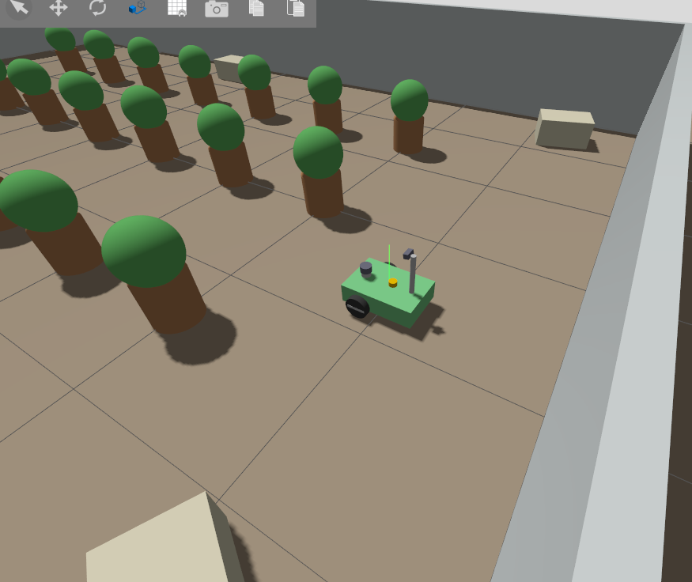

# SeraBot

Sera koridorlarında devriye gezen, engellerden kaçan ve kırmızı etiketli hasta bitkiyi fark eden diferansiyel sürüşlü mobil robot.
BIMU4101 – Introduction to Mobile Robotics, Midterm Project.



## Ortam
- Ubuntu 26.04 LTS
- ROS 2 Lyrical
- Gazebo Jetty

## Paketler
| Paket | İçerik |
|---|---|
| `serabot_description` | URDF/Xacro robot modeli, modeli RViz'de gösteren `display.launch.py` |
| `serabot_gazebo` | Sera dünyası (`greenhouse.sdf`), `sim.launch.py`, `ros_gz_bridge` ayarları, RViz config |
| `serabot_behavior` | Python davranış düğümleri |

## Kurulum

### 1. Bağımlılıklar
ROS 2 Lyrical ve Gazebo Jetty kurulu olmalı. Ek paketler:
```bash
sudo apt install ros-lyrical-ros-gz ros-lyrical-xacro ros-lyrical-robot-state-publisher \
  ros-lyrical-joint-state-publisher-gui ros-lyrical-teleop-twist-keyboard ros-lyrical-tf2-tools \
  ros-lyrical-rqt-image-view ros-lyrical-rqt-plot
```

### 2. Klonlama ve build
Repo kökü aynı zamanda colcon workspace'idir.
```bash
git clone https://github.com/metehanyurdunusvn/serabot.git ~/serabot
cd ~/serabot
source /opt/ros/lyrical/setup.bash
colcon build --symlink-install
source install/setup.bash
```
> Yeni bir dosya eklendiğinde `colcon build` tekrar çalıştırılmalıdır. `--symlink-install` sayesinde var olan dosyalardaki değişiklikler için build gerekmez.

## Çalıştırma

### Simülasyon (Gazebo + RViz)
```bash
ros2 launch serabot_gazebo sim.launch.py
```
Sırasıyla Gazebo'yu sera dünyasıyla, `robot_state_publisher`'ı, robotun spawn edilmesini, `ros_gz_bridge`'i ve RViz'i başlatır.

| Argüman | Varsayılan | Açıklama |
|---|---|---|
| `world` | `greenhouse.sdf` | Gazebo world dosyası |
| `x`, `y`, `yaw` | `-4.0`, `0.7`, `0.0` | Başlangıç konumu ve yönü |
| `rviz` | `true` | RViz açılsın mı |
| `behavior` | `false` | Engelden kaçma düğümü (`obstacle_avoider`) başlatılsın mı |

### Teleop ile sürüş
`/cmd_vel` `geometry_msgs/msg/TwistStamped` tipindedir, bu yüzden `stamped:=true` gerekir:
```bash
ros2 run teleop_twist_keyboard teleop_twist_keyboard --ros-args -p stamped:=true
```
`i` ileri, `,` geri, `j`/`l` dönüş, `k` dur.

### Kamera görüntüsü
Kamera direğin tepesindedir: 640×480, 30 Hz, yatay görüş açısı 60°, 10° aşağı bakar. Görüntü mesajlarının frame'i `camera_optical_link`'tir (z ileri, x sağa, y aşağı). RViz'de `Camera` adlı Image display'i hazırdır; ayrıca:
```bash
ros2 run rqt_image_view rqt_image_view /camera/image_raw
```
```bash
ros2 topic hz /camera/image_raw
ros2 topic echo /camera/camera_info --once
```

### IMU grafikleri
Dönüş hızı (`angular_velocity.z`) ve ileri ivme (`linear_acceleration.x`):
```bash
ros2 run rqt_plot rqt_plot /imu/angular_velocity/z /imu/linear_acceleration/x
```
Robot yerinde dönerken `angular_velocity.z` komut verilen açısal hıza yaklaşır; hızlanma ve frenlemede `linear_acceleration.x` kısa tepeler yapar. Dururken `linear_acceleration.z` ≈ 9.81 m/s²'dir.

### Otonom engelden kaçma
```bash
ros2 launch serabot_gazebo sim.launch.py behavior:=true
```
veya simülasyon açıkken ayrı terminalde:
```bash
ros2 run serabot_behavior obstacle_avoider --ros-args -p use_sim_time:=true
```
`obstacle_avoider` düğümü `/scan`'i dinler ve `/cmd_vel`'e `TwistStamped` yayınlar (10 Hz):
- Ön ±30° sektördeki tüm geçerli ölçümler 0.6 m'den uzaksa **ileri** gider.
- Değilse yerinde, sol (30°…90°) ve sağ (−90°…−30°) sektörlerden ortalama boş alanı **daha fazla olan tarafa döner**; ön açılana kadar aynı yöne dönmeye devam eder (duvar önünde sağ-sol titremesini önler).
- `NaN` ölçümler atlanır, `+Inf` boş kabul edilir, `range_min` altı ve `-Inf` engel kabul edilir.
- `scan_timeout` süresince yeni `/scan` gelmezse veya ön sektörde hiç geçerli ölçüm yoksa **durur**.

Teleop ile aynı anda çalıştırmayın: ikisi de `/cmd_vel`'e yazar.

| Parametre | Varsayılan | Açıklama |
|---|---|---|
| `obstacle_threshold` | `0.6` | Ön sektörde engel sayılma mesafesi (m) |
| `front_half_angle_deg` | `30.0` | Ön sektörün yarı açısı (°) |
| `side_max_angle_deg` | `90.0` | Yan sektörlerin dış sınırı (°) |
| `forward_speed` | `0.2` | İleri hız (m/s) |
| `turn_speed` | `0.6` | Dönüş hızı (rad/s) |
| `scan_timeout` | `0.5` | Bu süreden eski tarama bayat sayılır (s) |
| `control_rate` | `10.0` | Komut yayınlama frekansı (Hz) |
| `frame_id` | `base_footprint` | `TwistStamped` başlığındaki frame |

Örnek: `ros2 run serabot_behavior obstacle_avoider --ros-args -p use_sim_time:=true -p obstacle_threshold:=0.7`

### Testler
Karar mantığı ROS'tan bağımsız `serabot_behavior/avoidance.py` içindedir ve birim testleri vardır:
```bash
colcon test --packages-select serabot_behavior
colcon test-result --verbose
```

### Sadece robot modeli (Gazebo olmadan)
```bash
ros2 launch serabot_description display.launch.py
```

## Konular
| Konu | Mesaj tipi | Yön | Görselleştirme |
|---|---|---|---|
| `/scan` | `sensor_msgs/msg/LaserScan` | Gazebo → ROS, 10 Hz | RViz LaserScan |
| `/imu` | `sensor_msgs/msg/Imu` | Gazebo → ROS, 100 Hz | rqt_plot |
| `/camera/image_raw` | `sensor_msgs/msg/Image` | Gazebo → ROS, 30 Hz, 640×480 | rqt_image_view, RViz Image |
| `/camera/camera_info` | `sensor_msgs/msg/CameraInfo` | Gazebo → ROS, 30 Hz | – |
| `/cmd_vel` | `geometry_msgs/msg/TwistStamped` | ROS → Gazebo (teleop veya `obstacle_avoider`) | – |
| `/odom` | `nav_msgs/msg/Odometry` | Gazebo → ROS | RViz Odometry |
| `/tf` | `tf2_msgs/msg/TFMessage` | Gazebo → ROS (`odom → base_footprint`) | RViz TF |
| `/joint_states` | `sensor_msgs/msg/JointState` | Gazebo → ROS | RViz RobotModel |
| `/clock` | `rosgraph_msgs/msg/Clock` | Gazebo → ROS | – |

## Sorun giderme
- **Sensörler veri basmıyor:** World dosyasında `gz-sim-sensors-system` ve `gz-sim-imu-system` plugin'lerinin olduğunu kontrol edin.
- **Eski dünya açılıyor veya Gazebo yavaş:** Arka planda eski bir Gazebo sunucusu kalmış olabilir.
  ```bash
  pgrep -af gz
  ```
  ```bash
  pkill -f gz-sim-main
  ```
- **`No such file or directory: ... .xacro`:** Yeni dosya eklendikten sonra `colcon build` çalıştırılmamış.
